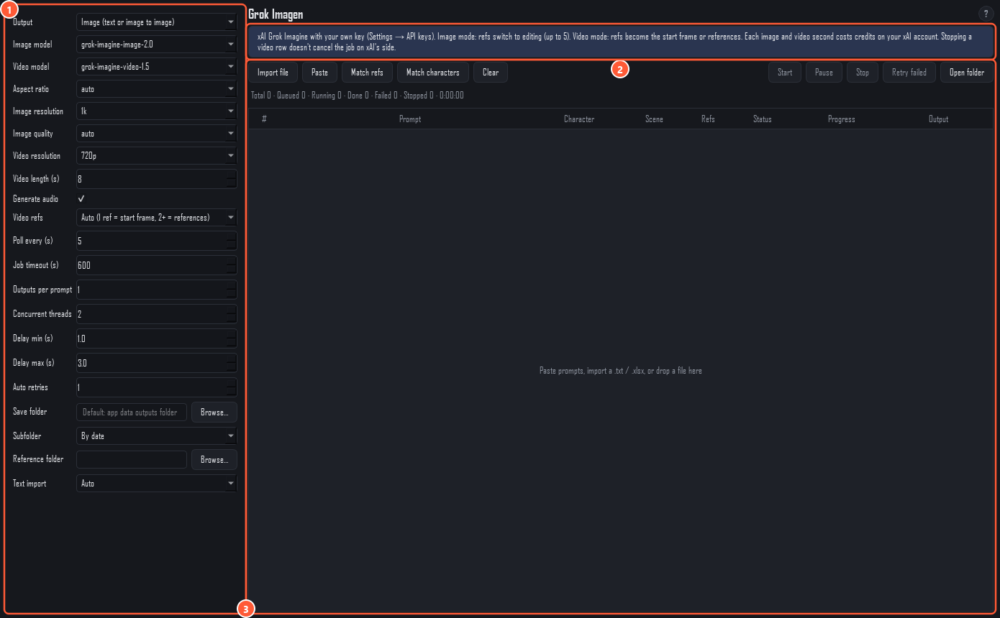

# Flow Video, Grok and OpenAI pages

These pages call paid APIs with **your own API keys** instead of Google Flow. They're hidden in Flow-only mode; [Getting started](getting-started.md) shows how to switch everything on and where the keys go (**Settings → API keys**). Each request is billed by the provider to your account.

They work like the [Flow Image page](flow-image.md): paste or import prompts, set the options on the left, press **Start**. Rows, settings and outputs belong to the active [project](projects.md). **Concurrent threads** and **Delay min/max** apply here: several jobs can run at once, with a random pause between them.

1. **Options for this provider.** They differ per page (below).
2. **Banner.** What the page uses and what it costs.
3. **Prompt table and toolbar.** The same as on Flow Image.

## Flow Video (Gemini API)

Video clips with Gemini Omni Flash through the Gemini API, with your Gemini key. Options: aspect ratio (16:9 or 9:16), resolution (360p to 4K), duration (auto, 4, 6, 8 or 10 s), mode, how often to check on a clip, and a job timeout. The mode decides what a row's reference images do:

- **Auto**: one image is the start frame, two are the start and end frames.
- **Text to video**: images are ignored.
- **Image to video**: start and end frame.
- **Subject references**: up to 3 images of a subject.

Clips carry Google's SynthID watermark.

> This page doesn't use Google Flow. Generating video through Flow in the browser isn't wired into the app yet.

## Grok Imagen (xAI)

Images or videos with your xAI key. **Output** picks image or video; only the matching options are used.

- Image: image model, aspect, resolution, quality. Rows with reference images (up to 5) are edits of those images.
- Video: video model, resolution, length (1–15 s), sound on or off, and how references are used (start frame or references).
- Stopping a video row doesn't cancel the job on xAI's side.

## OpenAI Image

Images with your OpenAI key. Options: model, size, quality, file format, background (for example transparent), moderation and a timeout. Rows with reference images use OpenAI's edit endpoint. Some OpenAI image models need a verified organization on your OpenAI account.

## When a job fails

The Output cell shows why. "No … API key" means the key is missing (see [Getting started](getting-started.md)). A wrong key fails at once and isn't retried. Rate limits and network errors are retried up to **Auto retries** times. A request the provider refuses for its content policy isn't retried. More in [Troubleshooting](troubleshooting.md).
