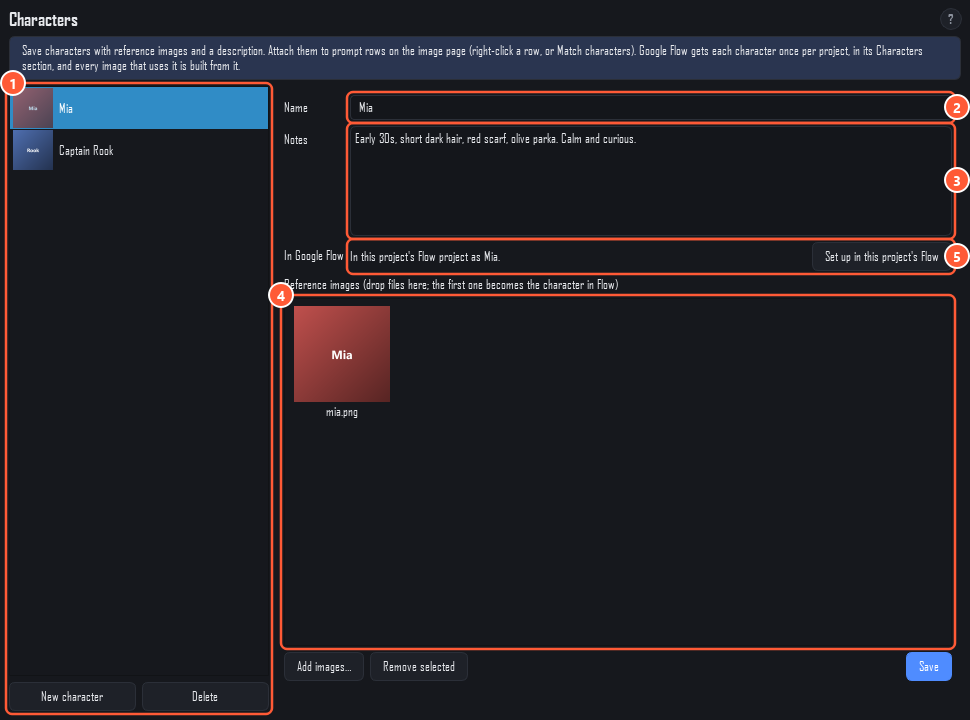

# Characters and scenes

A series reuses the same people and places in many images. Save them once in Labs Studio and attach them to prompt rows. Google Flow then gets them as real **Flow characters**, so faces, clothes and places stay the same from shot to shot.

- **Characters** are people (or animals, robots…): a name, a description and reference images.
- **Scenes** are places: a bunker, a street, a kitchen. Flow has no reusable "place" of its own, so the app stores a scene in Flow as a character marked as a place.

Both libraries are shared by **all** projects.

1. **Library.** Your saved characters. **New character** adds one, **Delete** removes it and its images.
2. **Name.** How you refer to it in prompts. **Match characters** on the image page looks for this name.
3. **Notes.** Look, outfit, personality. Flow reads this as the character's info. With no image, Flow generates the portrait from it.
4. **Reference images.** Drop files here or use **Add images…**. The **first** image becomes the character in Flow. Press **Save** to keep your changes.
5. **In Google Flow.** Whether it is already set up in this project's Flow project, or in other projects. **Set up in this project's Flow** does it now.

The **Scenes** page looks the same, with a **Description** instead of notes.

## Using them in prompts

1. Name them in the prompt: "Mia and Captain Rook share a meal in the Bunker".
2. On the [Flow Image page](flow-image.md) press **Match characters**. The **Character** and **Scene** columns fill in. Longer names win, so "Captain Mia" doesn't also count as "Mia".
3. Or right-click rows: **Attach character**, **Add character to the shot**, **Detach character**, **Set scene**, **Clear scene**.
4. Press **Start**.

## How they get into Google Flow

Before a job, and when you switch [projects](projects.md), Labs Studio makes sure every character and scene the rows use exists in that project's Flow project:

1. Already set up there: it's used by name.
2. Set up in another project: it's copied over.
3. Not set up anywhere: it's created from its **first image**. That costs no generation. With no image but with notes, Flow generates a portrait from the notes, which is an image generation.

It remembers where each one is set up. If you delete a character in Flow, the app notices and sets it up again.

## Good to know

- Characters and scenes share Flow's Characters section, so don't give a scene the same name as a character.
- Changing an entry's images or notes later doesn't update the copy already in Flow. Delete it in Flow and the app makes it again.
- **Detach character** clears every character on the row. There's no "remove just one" yet.
- Character voices (Gemini text-to-speech) are hidden in Flow-only mode because they need a Gemini API key. See [Getting started](getting-started.md).
- The [Webhook API](webhook-api.md) takes `characters` and `scenes` by name.
