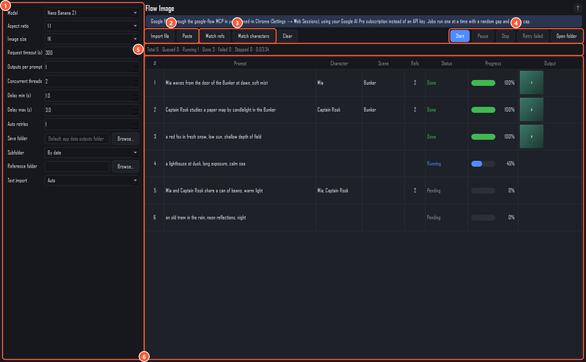

# Flow Image page

This is where you run a batch of image prompts through Google Flow. Sign in first: [Signing in to Google Flow](google-flow-sign-in.md).

1. **Settings.** Model, aspect ratio, image size and the rest (below). They are saved per [project](projects.md).
2. **Add prompts.** **Import file** loads a `.txt` or `.xlsx`, **Paste** takes text, and you can also drop a file on the table.
3. **Match refs / Match characters.** Attach reference images, or saved characters and scenes, to the rows that mention them.
4. **Run controls.** **Start**, **Pause**, **Stop**, **Retry failed** and **Open folder**.
5. **Counters.** Total, queued, running, done, failed and stopped rows, and the time the batch has taken.
6. **Prompt table.** One row per prompt with its character, scene, reference count, status, progress and output. Right-click rows for more.

## Settings

| Setting | What it does |
|---|---|
| Model | Nano Banana 2.1, Nano Banana Pro or Nano Banana 2 Lite |
| Aspect ratio | 16:9, 4:3, 1:1, 3:4 or 9:16 |
| Image size | 1K (original size) or 2K (upscaled by Flow). 4K isn't offered |
| Request timeout (s) | How long one job may take before it fails and is retried |
| Outputs per prompt | Images per prompt; Flow makes at most 4 at a time |
| Concurrent threads, Delay min/max | Used by the API pages. Google Flow always runs **one job at a time** with the gap set in Web Sessions |
| Auto retries | How many times a job that failed for a passing reason (timeout, download error) is tried again |
| Save folder | Where images go. Empty means the project's output folder, in a `flow_image` subfolder |
| Subfolder | None, by date, or one folder per batch |
| Reference folder | The folder **Match refs** looks in |
| Text import | How pasted or imported text is split: auto, one prompt per line, or blocks separated by a blank line |

## Adding prompts

- **Paste**: one prompt per line, or longer prompts separated by a blank line.
- **Import file**: a `.txt` file, or an `.xlsx` sheet. In a sheet the column headed `prompt` is used, otherwise column A.
- **Drop** a file on the table.

## Reference images

Put images in the **Reference folder**, then press **Match refs**. An image is attached to every row whose prompt contains its file name as a whole word or phrase (`red_car.png` matches "a red car at night"). An image named with a number (`3.png`) goes to row 3. The **Refs** column shows how many each row has. Flow is told to use them as references.

## Characters and scenes

Press **Match characters** to attach the saved [characters and scenes](characters-and-scenes.md) a prompt mentions by name, or right-click rows:

- **Attach character** replaces the row's character; **Add character to the shot** adds another one.
- **Detach character** clears them all.
- **Set scene** and **Clear scene**.

Flow gets them as real Flow characters, so faces, clothes and places stay the same from one image to the next.

## Running a batch

- **Start** runs every new row (status *pending*). **Pause** holds back the next job, and **Resume** carries on. **Stop** ends the batch; rows that didn't run show **stopped**.
- **Retry failed** puts failed and stopped rows back in the queue.
- Right-click a row for **Edit…**, **Retry**, **Remove**, **Open output** and **Open folder**. Double-click a row's Output cell to open its image, or its prompt to edit it.
- A failed row shows the reason in its Output cell. Some problems (sign-in, CAPTCHA, a usage limit, a change in Flow's page) **stop the whole queue** and bring the Chrome window to the front. See [Troubleshooting](troubleshooting.md).
- Rows and their results are saved with the project, so they're still there after a restart. Rows that were running come back as stopped.

Files are named after the row number and the start of the prompt, for example `001_a-red-fox-in-the-snow_1.jpg`.
