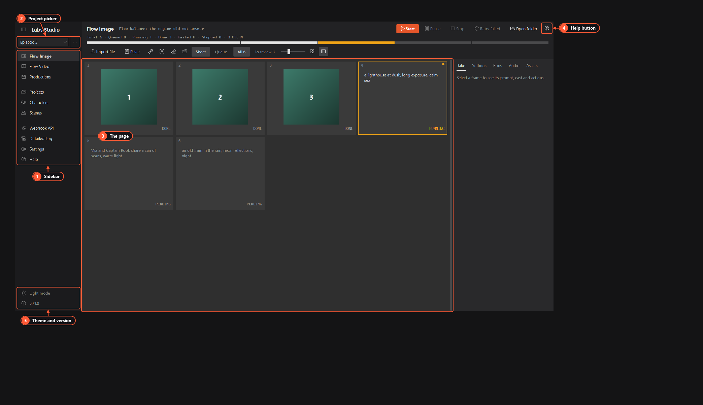

# Getting started

Labs Studio runs prompts in batches and saves the results to folders on your PC. This page covers the first launch: what you see, what is switched off, and where API keys go.



1. **Sidebar.** Every page of the app. The ☰ button at the top folds it down to icons.
2. **Project picker.** The active project. Each project keeps its own prompts, settings and output folder. See [Projects](projects.md).
3. **The page.** Here it's the [Flow Image page](flow-image.md), where most of the work happens.
4. **Help button.** Opens the help topic for the page you're on.
5. **Theme and version.** Switch between dark and light mode. Click the version to see the About box.

## Before your first batch

The default setup generates images with **Google Flow** in a Chrome window you sign in to yourself. You need:

- a Google account that can use Google Flow (Flow comes with Google's AI subscriptions and isn't offered in every country);
- Google Chrome;
- Node.js 18 or newer if you run Labs Studio from source. The app uses it to start the bundled google-flow MCP server.

Then follow [Signing in to Google Flow](google-flow-sign-in.md) once. After that, open [Flow Image](flow-image.md), paste some prompts and press **Start**.

Read [Terms of service and your account](terms-and-risks.md) before you start. Automating a website puts the account you use at risk.

## Flow-only mode: what is hidden

Labs Studio starts in **Flow-only mode**. It shows only what works end to end with Google Flow: Flow Image, Flow Video, Projects, Characters, Scenes, Webhook API, Detailed Log, Settings (Web Sessions tab) and Help.

| Hidden | Why |
|---|---|
| Settings → API keys tab | Nothing shown uses a key |

To show everything, close Labs Studio and do **one** of these:

- In `%APPDATA%\LabsStudio\settings.json`, add `"features": {"flow_only": false}` at the top level (keep the file valid JSON), then start the app again.
- Or set the environment variable `LABS_STUDIO_FEATURES` to `all` before you start the app. It wins over the setting, and `flow` forces Flow-only mode back on.

For example, in cmd.exe from the app folder, run these two commands:

```bat
set LABS_STUDIO_FEATURES=all
```

```bat
python run.py
```

## API keys

Open **Settings → API keys** (shown once everything is switched on).

1. **Key box.** Paste a key and press **Save**. **Show** reveals what you typed, **Remove** deletes the saved key.
2. **Status line.** Whether a key is saved, taken from an environment variable, or missing.
3. **Get a key.** Opens the provider's key page: Google AI Studio (Gemini), the OpenAI platform, or the xAI console (Grok).

Keys are stored in **Windows Credential Manager**, never in `settings.json`. If no key is saved, the app uses the provider's environment variable when one is set. The provider bills API calls to your account.

## Where things are saved

| What | Where |
|---|---|
| Settings | `%APPDATA%\LabsStudio\settings.json` |
| Projects, their prompts and outputs | `%APPDATA%\LabsStudio\projects\<id>\` (the data folder can be changed on the [Projects](projects.md) page) |
| Characters and scenes | `%APPDATA%\LabsStudio\characters\` and `%APPDATA%\LabsStudio\scenes\` |
| Logs | `%APPDATA%\LabsStudio\logs\`, also shown on the **Detailed Log** page |

Next: [Signing in to Google Flow](google-flow-sign-in.md).
