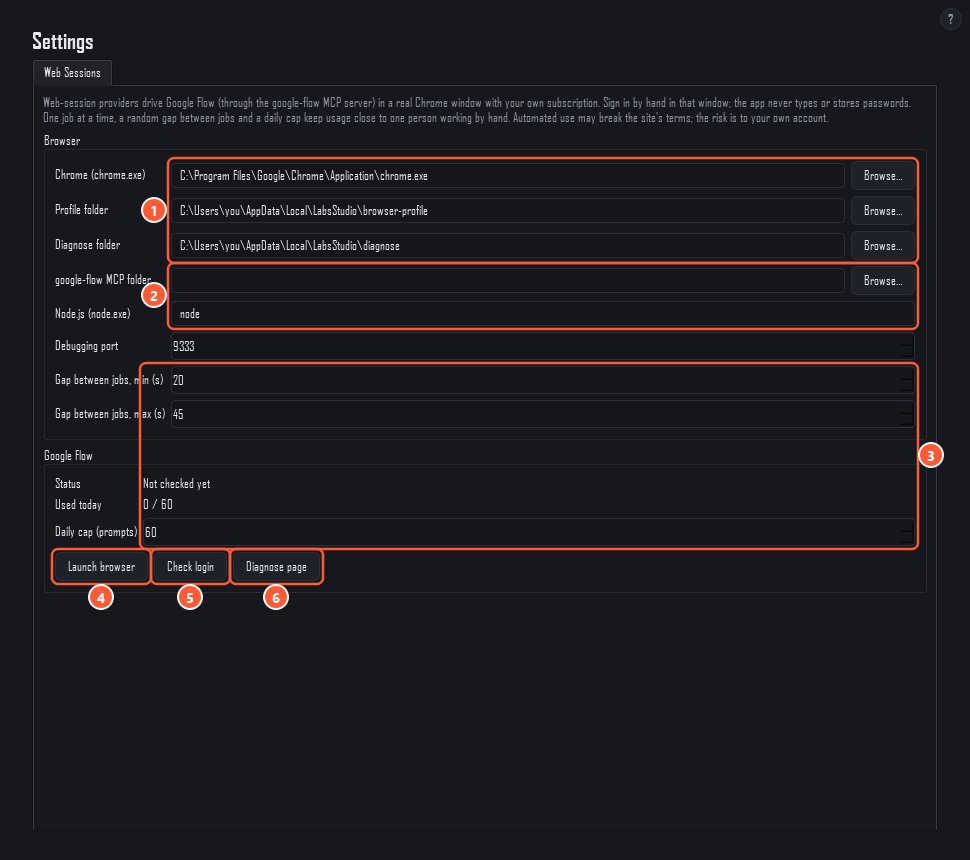

# Signing in to Google Flow

Labs Studio doesn't use an API for Google Flow. It opens a real Chrome window with its own profile, you sign in to Google there by hand, and the bundled **google-flow MCP server** works Flow's web page in that window, much as you would. The app never types, sees or stores your password.

Everything about that window is in **Settings → Web Sessions**.



1. **Browser.** The path to `chrome.exe`, the profile folder the app's Chrome uses, and the folder for diagnose snapshots. The profile folder keeps your sign-in, so you only sign in once. Further down is the **debugging port** (9333) the app and the MCP use to reach that Chrome.
2. **google-flow MCP folder and Node.js.** Leave the MCP folder empty to use the copy that ships with the app (`mcp/google-flow`). `node` must be on PATH, or give the full path to `node.exe`.
3. **Pacing.** The random gap between two jobs (20–45 s by default) and the **daily cap** (60 prompts by default; **Used today** counts what has run). These keep usage close to one person working by hand.
4. **Launch browser** starts Chrome with the profile and port above.
5. **Check login** looks at Flow in that window and reports **Signed in**, **Not signed in**, a CAPTCHA, or a usage limit.
6. **Diagnose page** saves a snapshot of the page to the diagnose folder, for when something looks wrong.

## First sign-in, step by step

1. Install Google Chrome if you don't have it.
2. If you run from source, install Node.js 18 or newer. Then, in cmd.exe, go to the app's `mcp\google-flow` folder and run:

   ```bat
   npm ci
   ```

3. Open **Settings → Web Sessions** and press **Launch browser**. A new Chrome window opens. It is separate from your normal Chrome and has its own profile.
4. In that window go to `https://flow.google.com/`, sign in with **your own** Google account, and accept anything Flow asks the first time.
5. Back in Labs Studio, press **Check login**. It should say **✓ Signed in**.
6. Leave that Chrome window open; you can minimise it. If you close it, the next job opens it again.

## While a batch runs

- Jobs run one at a time, with a random gap between them.
- Don't click around in that Chrome window during a batch. The MCP is working in it.
- Don't let another program generate in the same Chrome at the same time, for example your own agent using the MCP ([Use the google-flow MCP from your own agent](mcp-agents.md)). The two would fight over the same tab.
- If Flow asks you to sign in again, shows a CAPTCHA, or says you've hit a limit, the queue **stops** and the Chrome window comes to the front. Sort it out there yourself, then press **Retry failed** on the page.

Each [project](projects.md) gets its own project in Flow. It's created the first time it's used and titled with the project's name.

See also: [Troubleshooting](troubleshooting.md), [Terms of service and your account](terms-and-risks.md).
