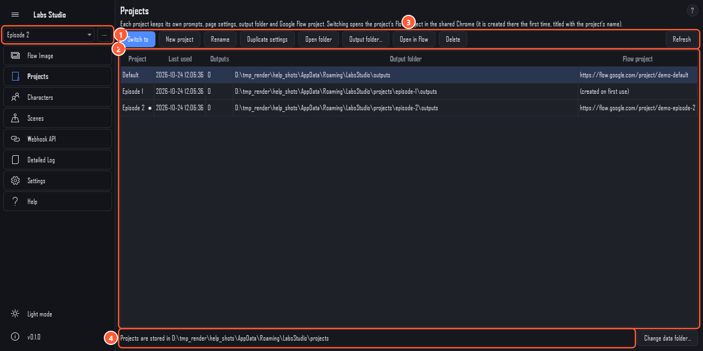

# Projects

A project is one piece of work: a video, a client, a series episode. Each project keeps its own:

- prompt rows on every page, with their status and results;
- page settings (model, aspect, folders…);
- output folder;
- **Google Flow project**, created in Flow the first time it's needed and titled with the project's name.

The first start creates a project called **Default**.

1. **Project picker.** Under the sidebar header, always visible. Pick a project to switch to it. The **⋯** menu next to it has New project, Rename, Duplicate settings, Open folder, Open in Flow and Delete.
2. **Project list.** Name, last used date, number of output files, output folder and Flow project link. Select a row and press **Switch to** to make it active.
3. **Actions.** They act on the selected row: Switch to, plus the ⋯ menu's actions, plus **Output folder…** to pick where this project's files go and **Refresh**.
4. **Data folder.** Where all projects are stored. **Change data folder…** makes Labs Studio use another folder after a restart. Projects in the old folder are not moved.

## Switching

- Switching is refused while a batch runs on any page. Stop it or let it finish first.
- The generator pages are rebuilt from the new project's rows and settings.
- The window title shows the active project.
- Labs Studio opens the project's Flow project in the Chrome window, then sets up any [characters and scenes](characters-and-scenes.md) its prompts use. This can be turned off with the setting `web.flow_open_on_switch`.

## Duplicate, rename, delete

- **Duplicate settings** makes a new project with the same page settings and no prompts.
- **Rename** on the active project also renames its project in Google Flow.
- **Delete** asks first. **Delete, keep files** removes the project from the app and leaves its output folder alone; **Delete with files** removes the folder too. The last project can't be deleted. Deleting in the app never deletes the project in Google Flow; do that in Flow if you want to.

The [Webhook API](webhook-api.md) can also choose a project per request with `"project"`.
