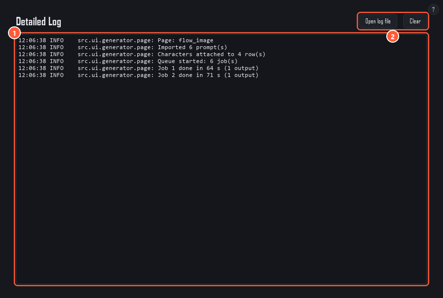

# Troubleshooting

Start with the **Detailed Log** page. It shows everything the app does, and **Open log file** opens the full log from `%APPDATA%\LabsStudio\logs\`. A failed row also shows its reason in the Output cell; hover over it to read all of it.

1. **The log.** Newest lines at the bottom.
2. **Open log file / Clear.** Clear only empties this view, not the file.

## Google Flow

| What you see | What to do |
|---|---|
| "Google Flow wants you to sign in…", or **Not signed in** in Web Sessions | Sign in by hand in the Chrome window the app opened, then **Retry failed**. See [Signing in to Google Flow](google-flow-sign-in.md) |
| A CAPTCHA or "verify it's you" | Solve it yourself in that Chrome window. The app never tries to get around it |
| A usage limit, or the daily cap reached | Wait until the limit resets, or raise the daily cap in Web Sessions if you're sure. Flow's own limits come from your Google plan |
| "Wrong Google account" | The Chrome window is signed in to a different account than expected. Sign out there and sign in with the right one |
| The google-flow MCP server doesn't start | Install Node.js 18 or newer, make sure `node` works in cmd.exe, and run `npm ci` once in `mcp\google-flow`. Check **Node.js** and **google-flow MCP folder** in Web Sessions |
| Chrome doesn't open | Check the `chrome.exe` path in Web Sessions. Another program on port 9333? Change the **Debugging port** |
| "UI changed", or every job fails at the same step | Google changed Flow's page. Press **Diagnose page** in Web Sessions and keep the snapshot, then check for an app update |
| One prompt fails with a refusal | Flow declined that prompt, for example for its content policy. Change the prompt; the others carry on |
| Timeouts | Flow was slow. Raise **Request timeout** on the page. Timeouts are retried by themselves |
| A batch and your agent at the same time | Only one program should generate in the app's Chrome at a time. See [Use the google-flow MCP from your own agent](mcp-agents.md) |
| A character keeps getting set up again | It was renamed or deleted in Flow. The app sets it up again by its name. See [Characters and scenes](characters-and-scenes.md) |
| 4K isn't offered | Flow's 4K download isn't available on every plan, so the app offers 1K and 2K only |

## API pages

| What you see | What to do |
|---|---|
| "No … API key" | Add the key in **Settings → API keys**. See [Getting started](getting-started.md) |
| The key is refused, or "refused the request" (403) | Check the key on the provider's site. Some OpenAI image models need a verified organization |
| Rate limited (429), server errors | Retried by themselves up to **Auto retries**. Lower **Concurrent threads** |

## Tools and editor

| What you see | What to do |
|---|---|
| "ffmpeg not found" or "Real-ESRGAN not found" | Install it and put it on PATH, or set its path in **Settings → Tools** (the Video Editor has its own ffmpeg box). See [Video Cut and Image Upscaler](video-tools.md) |
| Export fails on a long timeline | Use ffmpeg 7 or newer |

## Other

| What you see | What to do |
|---|---|
| A page I read about is missing | It's hidden in Flow-only mode. See [Getting started](getting-started.md) |
| Can't switch projects | A batch is running. Stop it or let it finish. See [Projects](projects.md) |
| The webhook answers 401 | Send the token: `-H "Authorization: Bearer YOUR-TOKEN"`. See [Webhook API](webhook-api.md) |
| The webhook answers 404 for a page | That page is hidden or doesn't take jobs. `GET /api/pages` lists the ones that do |

## Where files are

| What | Where |
|---|---|
| Settings | `%APPDATA%\LabsStudio\settings.json` |
| Logs | `%APPDATA%\LabsStudio\logs\` |
| Projects and outputs | `%APPDATA%\LabsStudio\projects\` (or the data folder set on the Projects page) |
| Characters and scenes | `%APPDATA%\LabsStudio\characters\`, `%APPDATA%\LabsStudio\scenes\` |
| Diagnose snapshots | The **Diagnose folder** in Web Sessions |

When you ask for help, include the lines from the log around the error. Remove anything private first, such as your email address.
