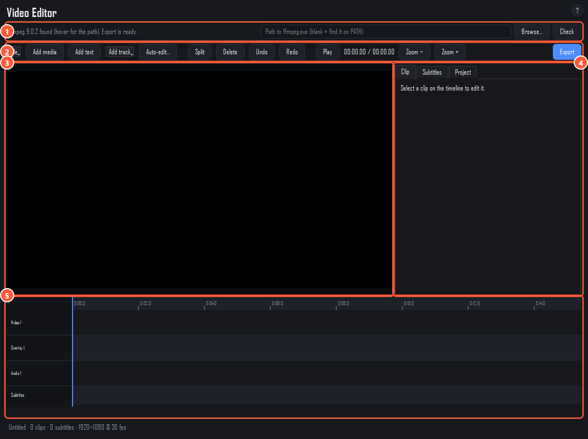

# Video Editor

A small timeline editor for turning generated images and clips into a video, with music, titles and subtitles. It exports an MP4 with **ffmpeg**, which you install yourself (for example `winget install Gyan.FFmpeg`). It's hidden in Flow-only mode; see [Getting started](getting-started.md) to show it.

1. **ffmpeg.** Whether ffmpeg was found. Give the path to `ffmpeg.exe` here if it isn't on PATH, then press **Check**.
2. **Toolbar.** File (new, open, save editor projects as `.lsproj`), **Add media**, **Add text**, **Add track**, **Auto-edit…**, **Split**, **Delete**, **Undo** / **Redo**, **Play**, zoom and **Export**.
3. **Preview.** The frame at the playhead. Video clips show as a tile here; the real picture and the sound are only in the export.
4. **Inspector.** **Clip** (timing, fades, volume, position, size, opacity, text), **Subtitles** and **Project** (resolution, frame rate, background).
5. **Timeline.** Video, overlay and audio tracks. Drag clips to move them, drag their edges to trim.

## Auto-edit

**Auto-edit…** builds a slideshow from a folder of images or clips in one go: seconds per image, a crossfade between them, a maximum length per clip, optional music (looped to fit) and its volume, and whether to keep the clips' own sound. Then fine-tune it on the timeline.

## Subtitles

On the **Subtitles** tab: add a cue at the playhead, edit its start, end and text, import `.srt` or `.ass`, or save the cues as `.srt`. Style: font, size, colour, outline, shadow, bold, italic, position (bottom, middle, top), edge margin and a background box. Tick **Burn subtitles into the video** to draw them into the picture.

## Export

**Export** writes an H.264 + AAC MP4 at the project's resolution and frame rate, and can also save the subtitles as an `.srt` next to it. **Cancel** stops it and removes the partial file. If ffmpeg isn't found, export is off until you set its path at the top of the page.

Large timelines need ffmpeg 7 or newer.
