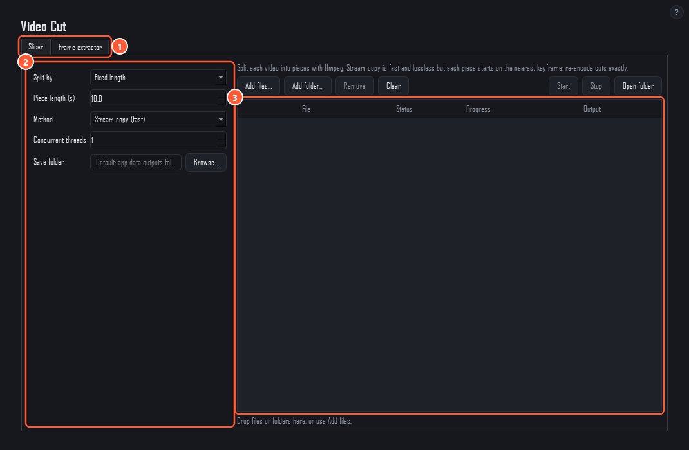
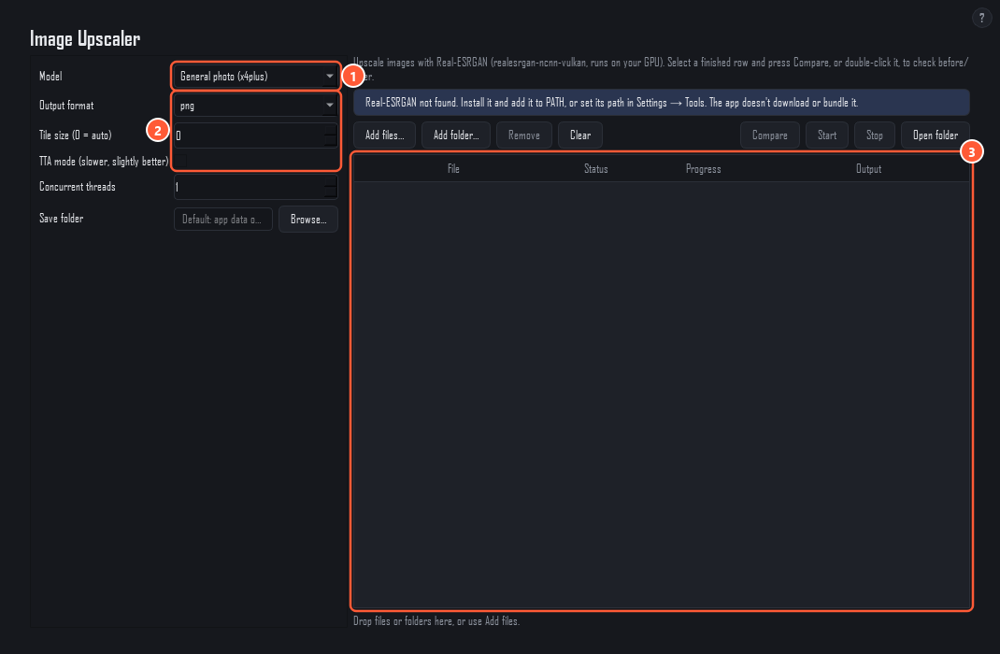

# Video Cut and Image Upscaler

Two batch tools that run programs on your own PC. They're hidden in Flow-only mode; see [Getting started](getting-started.md) to show them. Nothing is uploaded anywhere.

You install the programs yourself. The app doesn't download or bundle them:

- **ffmpeg** for Video Cut (and the [Video Editor](video-editor.md)). For example `winget install Gyan.FFmpeg`.
- **Real-ESRGAN** (`realesrgan-ncnn-vulkan.exe` with its `models` folder) for the Image Upscaler. It runs on your graphics card.

Put them on PATH, or set their paths in **Settings → Tools**. That tab says whether each one was found.

Both pages work the same way: add files or a whole folder (**Add files…**, **Add folder…**, or drop them on the list), choose the options on the left, press **Start**. Each row shows its status, progress and output. Outputs go to the **Save folder**, or to the active [project](projects.md)'s output folder when that is empty.

## Video Cut

1. **Slicer / Frame extractor tabs.**
2. **Options.** How to split, and how to cut.
3. **Files.** The videos to process, with status, progress and output.

**Slicer** splits each video into pieces:

- **Split by**: a fixed length, a number of equal parts, or custom ranges such as `0:05-0:12, 1:00-` (an open end means "to the end").
- **Method**: **Stream copy** is fast and lossless, but each piece starts on the nearest keyframe, so lengths can be off by a moment. **Re-encode H.264** cuts exactly, at the quality you set (CRF; lower is better).

**Frame extractor** saves still images from each video into its own folder: one frame every N seconds, N evenly spaced frames, every frame, the first or last frame, or frames at given timestamps (`0:01, 0:12.5`). PNG or JPG.

## Image Upscaler

1. **Model.** General photo (x4plus), anime or illustration (x4plus-anime), or anime video v3. Only anime video v3 has a **Scale** choice (x2, x3, x4); the others enlarge x4.
2. **Options.** Output format, tile size (0 = automatic; lower it if your graphics card runs out of memory) and TTA mode (slower, slightly better).
3. **Files.** Select a finished row and press **Compare** (or double-click it) to see before and after side by side.
