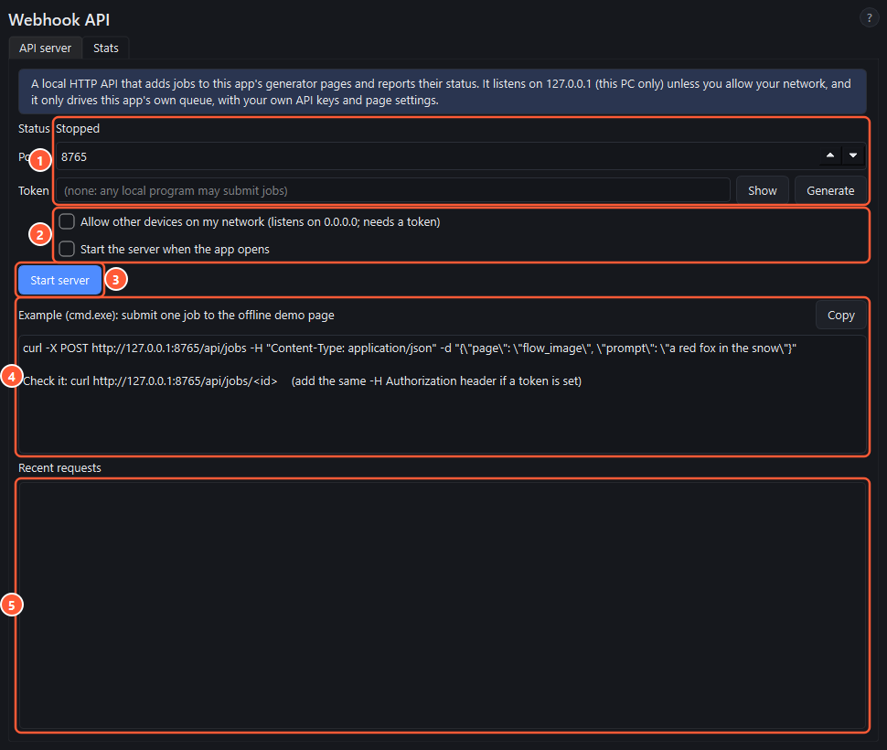

# Webhook API

A small HTTP API built into Labs Studio. Other programs (a script, an automation tool, your own agent) can use it to add prompts to a page, start them, and ask how they're doing. It only drives this app's own queue, with the page's current settings. The app has to be running.



1. **Status, port and token.** The server listens on `127.0.0.1` (this PC only), port **8765** by default. Set a **token** (or press **Generate**) so other programs on your PC can't submit jobs without it.
2. **Network and autostart.** **Allow other devices on my network** listens on all network interfaces and needs a token. The token travels unencrypted (no HTTPS), so only use it on a network you trust. **Start the server when the app opens** does what it says.
3. **Start server / Stop server.**
4. **Example.** A ready-made curl command for the current port and token, with a **Copy** button.
5. **Recent requests.**

The **Stats** tab counts every finished job per provider (jobs run, succeeded, failed, stopped, outputs, success rate), whether the job came from the app or the API.

## Endpoints

| Method and path | What it does |
|---|---|
| `GET /api/health` | App name, version, and whether a token is needed |
| `GET /api/pages` | Pages that accept jobs, their provider, and whether they're running |
| `POST /api/jobs` | Add prompts to a page (and start them). Answers **202** with the new jobs |
| `GET /api/jobs` | Jobs added over the API this session; `?page=flow_image` to filter |
| `GET /api/jobs/<id>` | One job: status, progress, attempts, error, output files |
| `GET /api/stats` | The Stats tab's counts |

With a token set, every request needs `Authorization: Bearer <token>` (or `X-Api-Token: <token>`). Without it the answer is **401**.

### `POST /api/jobs` body

| Field | Type | Meaning |
|---|---|---|
| `page` | string, required | `flow_image` or `flow_video` |
| `prompt` or `prompts` | string, or list of strings | Up to 1000 prompts per request |
| `refs` | list of file paths | Reference images on this PC, added to every prompt |
| `characters`, `scenes` | lists of names | From the [character and scene library](characters-and-scenes.md), matched without regard to case. An unknown name answers **400** and lists the known ones |
| `character` | string | Older single-character form, still accepted |
| `project` | name or id | Switch to this [project](projects.md) first. Default: the active one. Unknown: **404**. A batch is running so it can't switch: **409** |
| `start` | true or false | Start the queue right away. Default `true` |

A job's `status` is one of `pending`, `queued`, `running`, `done`, `failed` or `stopped`. When it's `done`, `outputs` lists the saved files.

## curl examples (cmd.exe)

curl ships with Windows 10 and 11. In cmd.exe, double quotes inside the JSON are written as `\"`. These examples use the default port with no token.

Check the server:

```bat
curl http://127.0.0.1:8765/api/health
```

Add two prompts to Flow Image and start them:

```bat
curl -X POST http://127.0.0.1:8765/api/jobs -H "Content-Type: application/json" -d "{\"page\": \"flow_image\", \"prompts\": [\"a red fox in the snow\", \"a lighthouse at dusk\"]}"
```

The same with a project, characters and a scene:

```bat
curl -X POST http://127.0.0.1:8765/api/jobs -H "Content-Type: application/json" -d "{\"page\": \"flow_image\", \"project\": \"Episode 2\", \"prompt\": \"Mia waves from the door of the Bunker\", \"characters\": [\"Mia\"], \"scenes\": [\"Bunker\"]}"
```

Ask about job 1:

```bat
curl http://127.0.0.1:8765/api/jobs/1
```

With a token, add the header to every command:

```bat
curl http://127.0.0.1:8765/api/jobs/1 -H "Authorization: Bearer YOUR-TOKEN"
```

## Good to know

- The API can't change page settings (model, aspect, count) per request. Jobs use whatever the page is set to.
- `start: true` on an idle page runs **every** pending row there, including rows you added by hand.
- Job ids are remembered only until the app closes. The files stay on disk.
- An agent that can't call HTTP can use the google-flow MCP directly instead: [Use the google-flow MCP from your own agent](mcp-agents.md).
