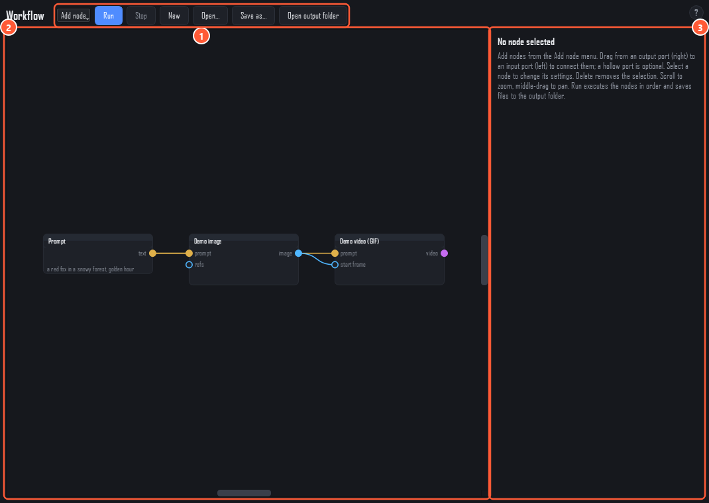

# Workflow editor

Chain steps together as nodes: a prompt goes into an image node, the image goes into a video node, and so on. Press **Run** and every node runs in order. It's hidden in Flow-only mode because it has no Google Flow node yet: its generator nodes use the **Gemini API with your own key**, or offline demo nodes. See [Getting started](getting-started.md) to show it.

1. **Toolbar.** **Add node**, **Run**, **Stop**, **New**, **Open…**, **Save as…** and **Open output folder**.
2. **Graph.** The nodes and their links. A new workflow starts with a small prompt → image → video chain made of demo nodes.
3. **Inspector.** The selected node's title, settings, and the files it made in the last run (double-click one to open it).

## Working with nodes

- Add nodes from the **Add node** menu: *Basic* (Prompt, Join text, Image file), *Google Gemini (your key)* (Gemini image, Gemini Omni video) and *Demo (offline)* (Demo image, Demo video, which writes a GIF).
- Drag from an output port (right side) to an input port (left side) to connect them. A hollow port is optional.
- Select a node to change its settings in the inspector. **Delete** removes the selection.
- Scroll to zoom, drag with the middle mouse button to pan.

Workflows are saved as `.json` in `%APPDATA%\LabsStudio\workflows\`, and the current one is saved automatically.

## Good to know

- Each **Run** runs the whole graph again. With Gemini nodes, that bills your key again.
- No undo, copy and paste, or rerunning a single node yet.
- Workflow runs aren't counted on the Webhook page's Stats tab.
